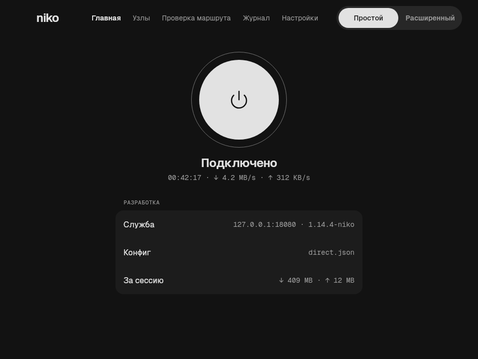
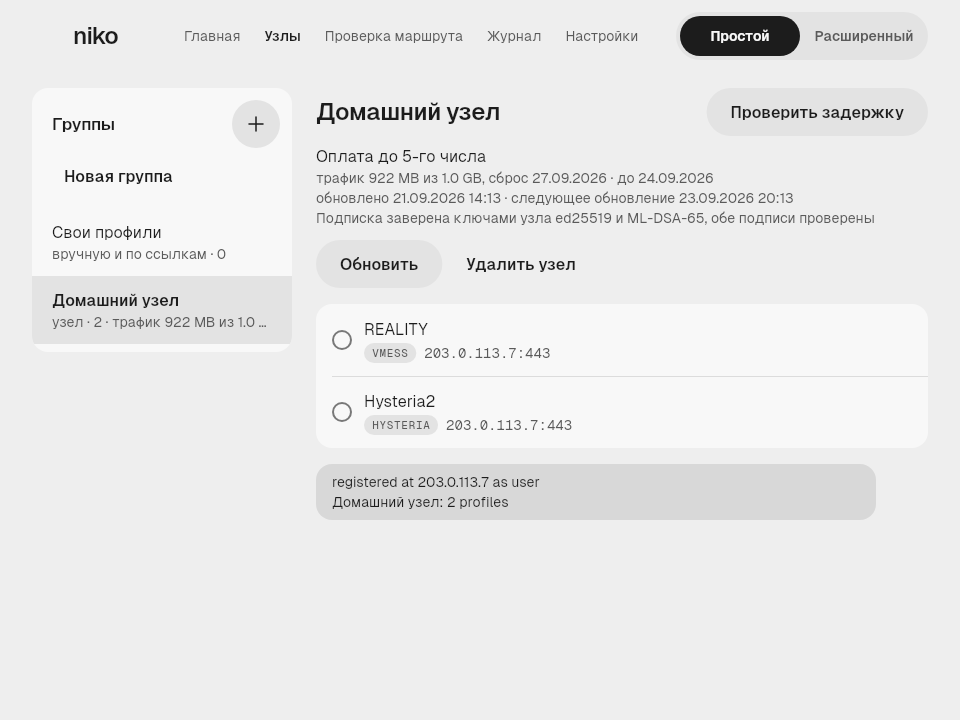
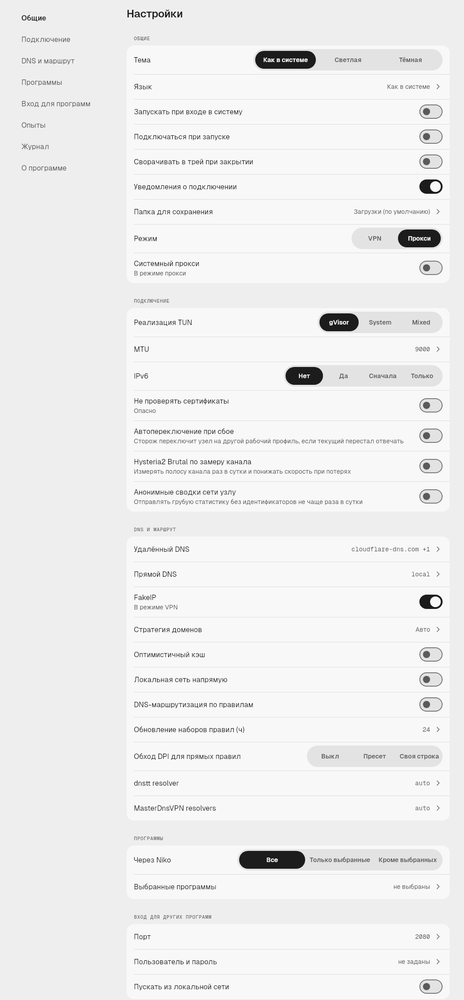

# Niko for the computer: the window

English | [Русский](README.ru.md)

The window of [Niko](https://github.com/arngory/niko) for Windows, Linux, and macOS (minimal base), in Flutter. It only
shows and asks: the core and Niko's logic live in the daemon, `nikod` (the core's `boxdd` with Niko's `NikoService`,
API 17, beside it), which the window talks to over gRPC. What the window can do and where its parts are is in
[README.ru.md](README.ru.md); the design is Niko's
[docs/design/desktop.md](https://github.com/arngory/niko/blob/main/docs/design/desktop.md) and
[docs/design/desktop-stage3.md](https://github.com/arngory/niko/blob/main/docs/design/desktop-stage3.md).

<p>
  
</p>

The pictures are the widget tests' goldens (`test/goldens/`), the window as it is now.

## What lives where

- **Here:** the window (`lib/`, `windows/`, `linux/`), its tests (`test/`, the screens' pictures in
  `test/goldens/`), its tools (`tool/`) and its CI (`.github/workflows/ci.yml`): analysis, tests, the test against
  the real daemon, the release builds of the window as archives.
- **In [arngory/niko](https://github.com/arngory/niko):** the daemon and its Go (`libcore/cmd/nikod`,
  `libcore/nikoservice`, `nikostore`, `nikoconf`, `nikofmt`, `nikosub`, …), the core's pin, the daemon's API
  (`shared/proto`), the design tokens and icons (`shared/tokens.json`, `shared/icons`) and the golden fixtures
  (`shared/golden`), next to the Android app's Kotlin they are checked against.
- The window pins Niko by commit in [`.github/niko.env`](.github/niko.env). A change that touches both is a pull
  request to Niko first, then one here that moves the pin to Niko's new commit.

## Building and testing against a Niko checkout

The tools and tests take Niko from `../niko` (a clone of arngory/niko beside this one, at the commit
`.github/niko.env` pins) or from the path in `NIKO_ROOT`, and the core from `../niko/../sing-box`, where Niko's
`./run lib core/init` puts it.

```
flutter pub get --enforce-lockfile
flutter analyze && dart analyze tool
flutter test                                    # all but the test against the real daemon
NIKO_DAEMON=<path to nikod> flutter test test/real_daemon_test.dart
tool/gen_proto.sh --check [<checkout of the core>]   # lib/gen against the core's protos and Niko's shared/proto
```

`niko-daemon` is built in Niko's `libcore` with the core's tags, as `ci.yml` does (job `daemon`, or locally via
`tool/build_daemon.sh --os linux --mode dev`). Add `-X main.development=true` only for dev/test builds that need
`--listen 127.0.0.1:<port>`:

```
cd ../niko/libcore
CGO_ENABLED=0 go build -trimpath -ldflags="-s -w -checklinkname=0 -X main.development=true" -tags=<the core's tags> -o niko-daemon ./cmd/nikod
```

The theme, the fonts and the icons of the window are generated by Niko's `shared/tool/gen_tokens.py` and
`gen_icons.py` with `--desktop <this checkout>`, as in `ci.yml`'s step "Generated files are current". The test of
VPN mode and of the system proxy change the machine: they run on Windows only with `NIKO_VPN_TEST=1` and
`NIKO_PROXY_TEST=1` (CI).

## Known desktop runner limits

- **Linux (Wayland):** Native Wayland rendering is supported on Flutter 3.50.1+ (Impeller is disabled by default; set
  `NIKO_IMPELLER=1` to opt in). System tray uses native GDBus StatusNotifierItem without deprecated
  `libayatana-appindicator`. On Wayland, launching a second instance activates the existing window via D-Bus, though
  without an activation token the compositor may not raise it above other windows.
- **Windows:** exported logs and crash reports save to `%USERPROFILE%\Downloads`; redirected Known Folders
  (such as OneDrive) are not resolved yet.
- **macOS:** minimal user-mode Proxy base (`networksetup` system proxy, Unix socket daemon, URL schemes); privileged
  TUN / LaunchDaemon packaging is not wired yet.

## Support the project

Niko is given as is, free. If it helps you, you can support its development: [donotpromise.space/donate](https://donotpromise.space/donate).

## License

GPL-3.0 or later, as Niko: see [LICENSE](LICENSE). The fonts Geist and Geist Mono are under the SIL Open Font
License 1.1, its text in `fonts/OFL.txt`. Contributing: [CONTRIBUTING.md](CONTRIBUTING.md).
