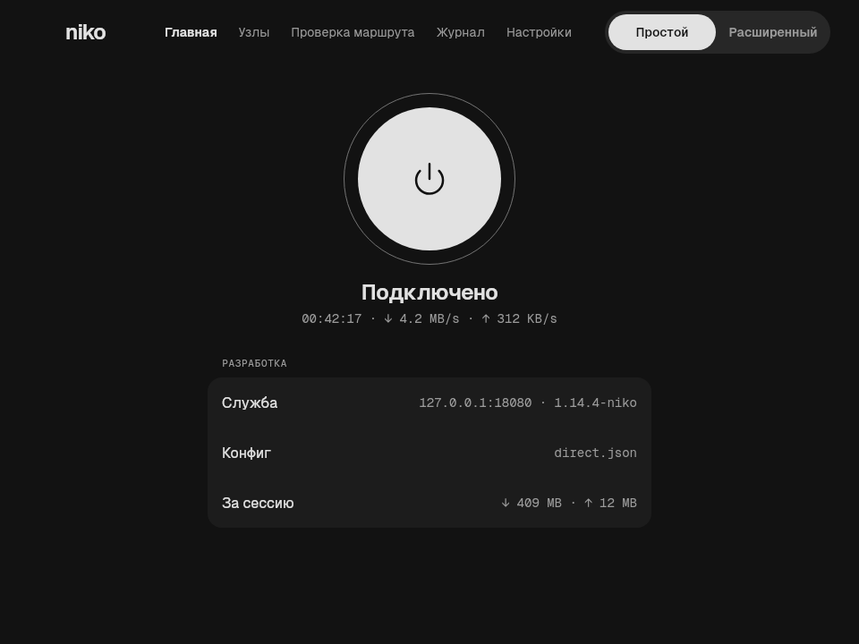
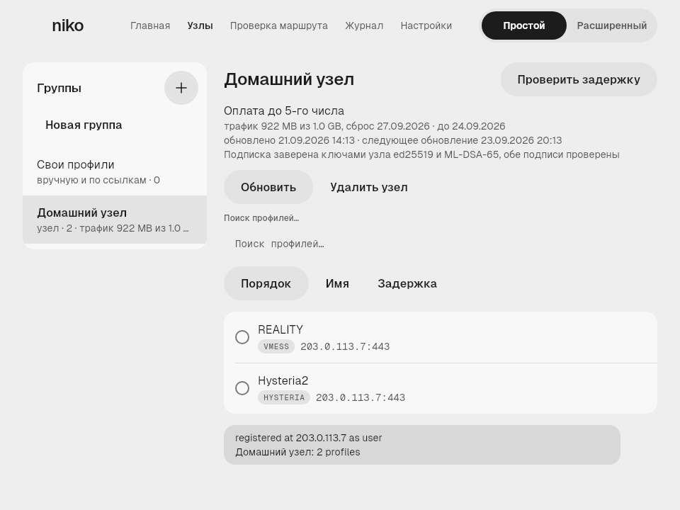
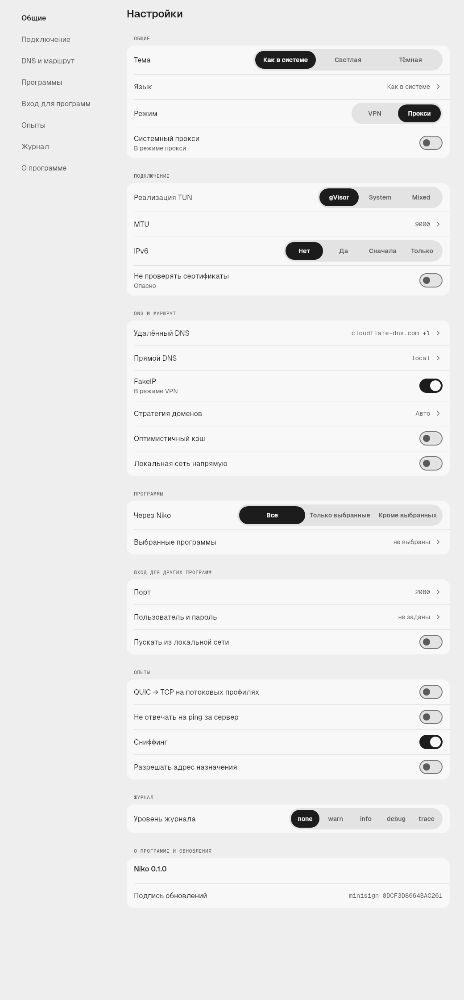
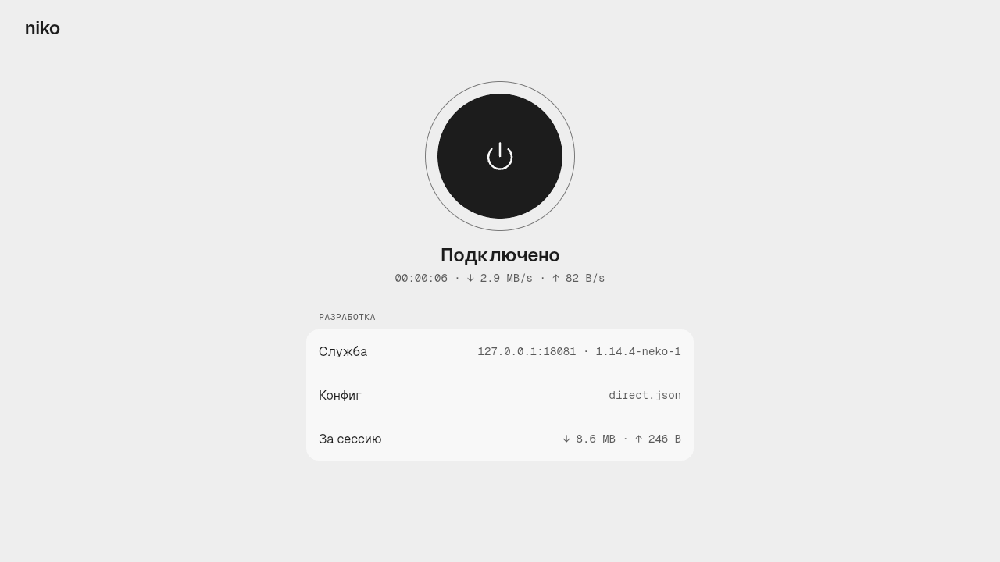

# Niko для компьютера: окно

[English](README.md) | Русский

Flutter, Windows сначала, Linux потом. Ядро и логика Niko живут в демоне (`boxdd` из форка ядра, дальше `nikod`);
окно только показывает и просит. Демон, его Go, proto, токены, значки и golden — в
[arngory/niko](https://github.com/arngory/niko); окно пинит его по коммиту (`.github/niko.env`). Как устроено
целиком — [docs/design/desktop.md](https://github.com/arngory/niko/blob/main/docs/design/desktop.md), что за каждым элементом экрана —
[desktop-requirements.md](https://github.com/arngory/niko/blob/main/docs/spec/desktop-requirements.md).

<p>
  
</p>

Картинки — эталоны виджет-тестов (`test/goldens/`): окно такое, какое оно сейчас.

Сейчас окно работает с `niko-daemon` (`boxdd` + `NikoService`, API 17):

- **Главная** (D-MAIN-01…18): кнопка подключает выбранный профиль службы (`Connect`, а в режиме разработки с `--config` —
  готовый JSON-конфиг), видны статус, время, скорость, задержка, строка узла и кнопка «Узнать IP выхода» (`ExitAddress`);
  под статусом — режим «Прокси / VPN» (D-NAV-02), смена при работающем ядре запускает его в новом режиме.
- **Прокси без службы и служба в один клик** (D-STATE-SVC): без прав администратора окно автоматически поднимает
  пользовательский `niko-daemon --user-mode`, так что импорт, профили и режим «Прокси» работают сразу. Для режима VPN
  (TUN) в настройках и на баннере есть установка системной службы в один клик (UAC на Windows, `pkexec` + резервная
  команда `sudo` на Linux) с переносом хранилища и удаление системной службы обратно в пользовательский режим.
- **Узлы, подписки и профили** (D-ADD-02…11, D-NODE-01…13, D-SUB-01…09, D-PROFILE-01…08): импорт ссылок, подписок,
  приглашений (`rcinv1/2/3`, `rcdev1`), файлов (`.txt`, `.json`, `.yaml`, `.conf`), системных URL-схем и QR-кодов из
  изображений; экспорт профиля ссылкой и QR; массовое измерение задержки (`TestProfiles`); ручной редактор протоколов
  (VLESS REALITY/XHTTP, Hysteria2, NaiveProxy HTTPS/QUIC + `naive-udp-v1`, VMess, Trojan, Trojan-Go, Shadowsocks, TUIC,
  AnyTLS, WireGuard/AmneziaWG, Mieru, SSH, SOCKS/HTTP) с разделом «Тонкая настройка» (пиннинг сертификатов, фрагментация
  TLS, DNS-туннели dnstt/MasterDnsVPN/Slipstream, стук портов, UDP-прелюдия, Yggdrasil) и проверкой `CheckProfile`.
- **Настройки и резервная копия** (D-SET-03…33, D-RULES-06): тема, язык, автозапуск, системная служба, программы через
  Niko, DNS, TUN, входящие, опыты, резолверы DNS-туннелей, корневые сертификаты naive, Yggdrasil, URL проверки соединения,
  Clash API, локальный экспорт/импорт резервной копии JSON (файл создаётся с правами `0600` / owner-only ACL до записи),
  проверка обновлений с проверкой подписи `minisign`, встроенный офлайн-FAQ.
- **Системный трей и фоновые циклы** (D-TRAY-01/02/07, BG-04/05/07/08): на Linux — нативный GDBus StatusNotifierItem
  без устаревшего `libayatana-appindicator`; в демоне работают сторож (`Watchdog`), динамический выбор резолверов
  DNS-туннелей по сети, подбор пиров Yggdrasil и статус `naive-udp-v1`.
- **Шапка** (D-NAV-01, D-NAV-03): разделы и переключатель вида «Простой / Расширенный». В «Простом» — Главная, Узлы,
  Проверка маршрута, Журнал и Настройки; в «Расширенном» добавляются Соединения и Правила (плюс Админ-панель при наличии
  админ-узла). Смена вида не трогает подключение и запоминается в `window.json`.
- **Проверка маршрута, Журнал, Отчёты, STUN, Соединения и Правила** (D-CHECK, D-LOG, D-CONN, D-RULES): проверка маршрута
  и наборов правил, журнал ядра с редактированием секретов (BG-10), экспорт отчётов о сбоях/OOM, STUN-тест NAT, таблица
  активных соединений, редактор правил и пресеты стран (Россия, Китай, Иран, блокировка рекламы).
- **Slipstream**: поддерживается внешний клиент `slipstream-client` рядом с бинарём демона (`tool/build_slipstream.sh`,
  вариант A) с автоматическим завершением при остановке/падении демона (`StopHook` + `Pdeathsig`) и UDP-маппингом резолверов.
- **macOS (минимальная база)**: платформенный слой `boxdd` (`networksetup` системный прокси), пользовательский сокет
  `niko-daemon` и схемы URL в `Info.plist`.

Журнал и соединения читаются у демона только пока открыт их экран. На Linux нативный Wayland работает из коробки на
Flutter 3.50.1 (`NIKO_IMPELLER=1` включает Impeller при желании); при повторном запуске окно активируется через D-Bus.
Для проверки и загрузки обновлений архив сохраняется после проверки `SHA256SUMS.minisig` для ручной распаковки.

**Связь с демоном не рвётся при остановке ядра.** Пакет `http2` на Dart закрывал всё соединение (PROTOCOL_ERROR,
«HTTP/2 clients cannot receive HEADER_FRAMEs»), когда окно отменяло поток соединений в тот же миг, когда демон сам
его закрывал. Это ловилось и против настоящего `boxdd`, и на Windows против тестового демона. Теперь при остановке
ядра окно не отменяет этот поток, а даёт ему закончиться (отменяет, только если он не закрылся за секунду). А если
работающая связь всё же оборвётся, окно сразу подключается снова и пишет «подключение», а не «служба не отвечает».
Тест с настоящим демоном требует, чтобы связь не рвалась ни разу до убийства демона.

## Что где

| Путь | Что |
|---|---|
| `lib/theme/tokens.g.dart` | Цвета, размеры и стили текста. **Сгенерирован** из `shared/tokens.json` Niko (`shared/tool/gen_tokens.py` там), руками не правится |
| `lib/ui/` | Компоненты дизайн-системы под теми же именами, что на холсте: кнопка подключения (`m-connect`), статус (`m-status`), баннер с действием, строки, шапка (`n-header`, `n-menu`), кнопка-значок, переключатель (`m-seg`), метка (`m-tag`), поле поиска |
| `lib/ui/icons.g.dart` | Значки окна. **Сгенерирован** из `shared/icons/lucide` Niko (`shared/tool/gen_icons.py` там, список `WINDOW`) — те же SVG, что у Android |
| `lib/platform/places.dart`, `lib/state/window_settings.dart` | Папки пользователя (настройки, «Загрузки») и запомненный вид |
| `lib/screens/shell.dart` | Окно под шапкой: какой раздел показан и в каком виде |
| `lib/screens/main_screen.dart` | Главная в виде «Простой». ID требований стоят в комментариях (`// D-MAIN-04`) |
| `lib/screens/log_screen.dart`, `tools_panel.dart`, `connections_screen.dart` | Журнал, инструменты рядом с ним, Соединения |
| `lib/state/connection_controller.dart` | Состояние подключения: связь с демоном, что делает ядро, трафик |
| `lib/state/log_feed.dart`, `connections_feed.dart` | Журнал и соединения: читают демон, пока открыт экран |
| `lib/state/stun_tool.dart` | Проверка NAT: шаги STUN-теста демона и итог |
| `lib/daemon/` | Клиент демона (gRPC) и адрес для режима разработки |
| `lib/gen/` | API демона на Dart. **Сгенерирован** из proto форка ядра и `shared/proto` Niko (`tool/gen_proto.sh`) |
| `lib/l10n/strings.dart` | Тексты, русский и английский. Временно здесь: переедут в общий слой с текстами Android |
| `test/` | Тесты; `test/goldens/` — снимки экрана в состояниях |
| `windows/runner/resources/app_icon.ico` | Значок окна: знак «Маршрут». Собирается `tool/make_icon.js` и `tool/make_icon.py` |

Material не используется: компоненты свои, на слое `widgets`. Так окно легче, и выглядит как макет, а не как Android.

## Режим разработки

`boxdd run --listen 127.0.0.1:<порт>` — это gRPC по TCP **без какой-либо проверки клиента**: любой процесс машины,
дошедший до порта, управляет ядром. Поэтому:

- демон в этом режиме запускает только `tool/dev.dart`, и только на `127.0.0.1`;
- окно собирается со связью по TCP только с `--dart-define=NIKO_DEV=true`. Без него кода этой связи в сборке нет,
  что бы ни стояло в аргументах; релиз собирается без него;
- адрес разбирает `DevEndpoint`: `127.0.0.1:<порт>` и больше ничего — ни имени, ни другого адреса.

```
dart run tool/dev.dart --daemon <путь к nikod> --config <файл.json>
```

`niko-daemon` — демон Niko: `boxdd` форка ядра и `NikoService` рядом (`libcore/cmd/nikod` в arngory/niko; для режима
разработки собирается с `-X main.development=true`, см. `tool/build_daemon.sh --os linux --mode dev`). В CI его
собирает `ci.yml` из пина Niko (артефакт `daemon-dev`, там же `boxdd` без `NikoService`). Конфиг — обычный JSON ядра;
для пробы хватит входа `mixed` на `127.0.0.1` и выхода `direct`.

## Проверки

Рядом с этим репозиторием — checkout arngory/niko на коммите из `.github/niko.env` (`../niko`, иначе путь в
`NIKO_ROOT`) и ядро на коммите, который пинит Niko (`../niko/../sing-box`, как его кладёт `./run lib core/init`
Niko):

```
flutter analyze
flutter test                      # всё, кроме теста с настоящим демоном
NIKO_DAEMON=<путь к nikod> flutter test test/real_daemon_test.dart   # без переменной тест пропускается
tool/gen_proto.sh --check [<checkout форка ядра>]
```

Тему, шрифты и значки окна пишут и проверяют генераторы Niko (`shared/tool/gen_tokens.py`, `gen_icons.py` с
`--desktop <этот checkout>`), как в шаге «Generated files are current» у `ci.yml`.

- `test/daemon_link_test.dart` — клиент и состояние против поддельного демона по настоящему gRPC на `127.0.0.1`.
- `test/main_screen_test.dart` — экран в состояниях, клавиатура, подписи для диктора, узкое окно; снимки
  сравниваются с `test/goldens/` (на Linux; обновить — `flutter test --update-goldens`).
- `test/real_daemon_test.dart` — настоящий `nikod`: запуск конфига, запрос через его прокси, счётчики трафика,
  остановка, убитый и вернувшийся демон, вызовы `NikoService` (приглашение узла — из golden Niko). В CI идёт на
  Windows и на Linux, на Windows ещё режим VPN (`NIKO_VPN_TEST=1`) и системный прокси (`NIKO_PROXY_TEST=1`).

Живой запуск (Linux, виртуальный экран, настоящий `boxdd`, трафик через прокси из конфига):



Шрифты Geist и Geist Mono — SIL Open Font License 1.1, текст в `fonts/OFL.txt`.

## Поддержать проект

Niko даётся как есть, бесплатно. Если он вам помогает, можно поддержать разработку: [donotpromise.space/donate](https://donotpromise.space/donate).
